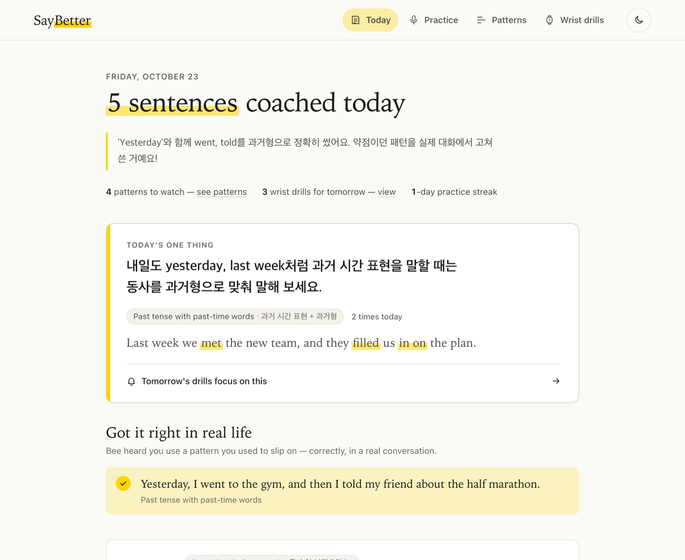
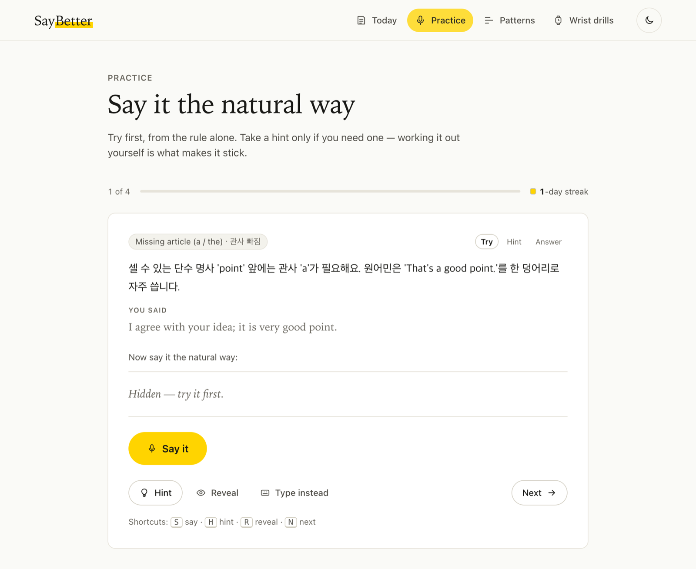
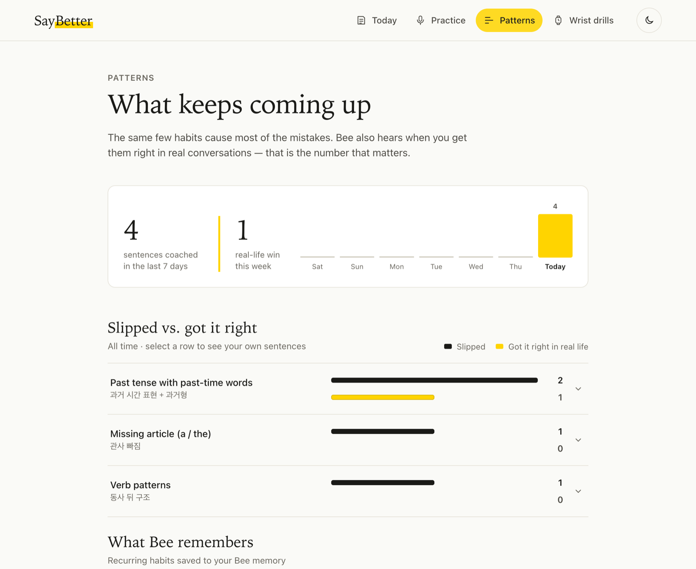
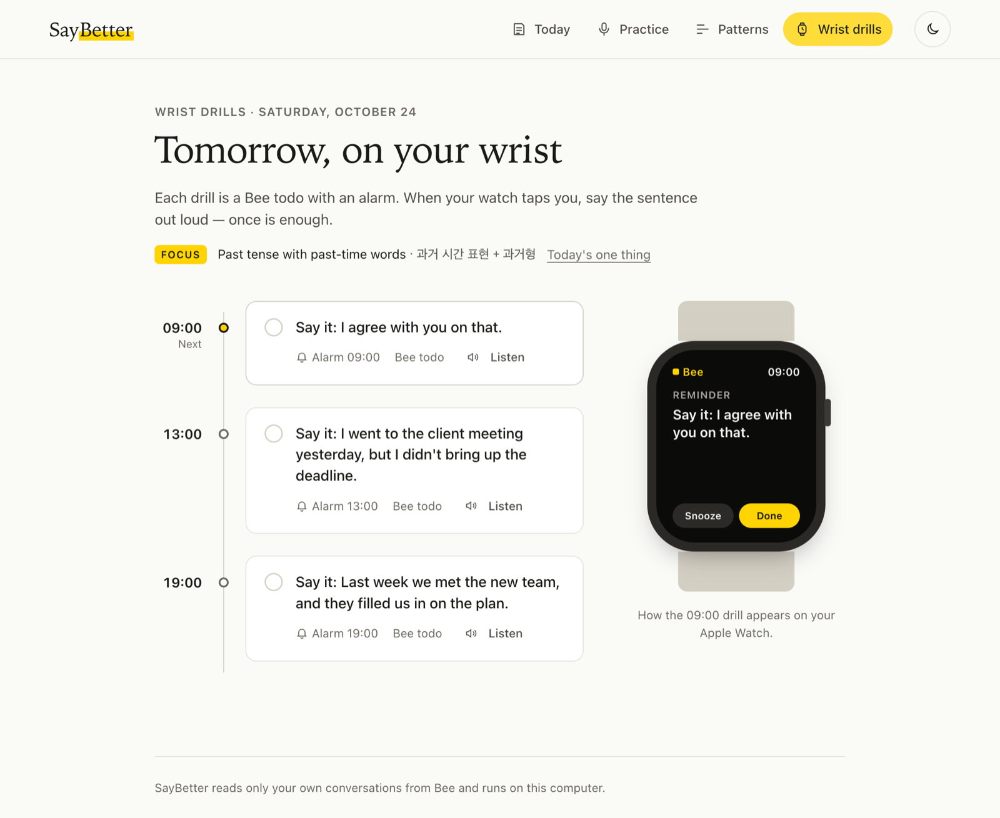
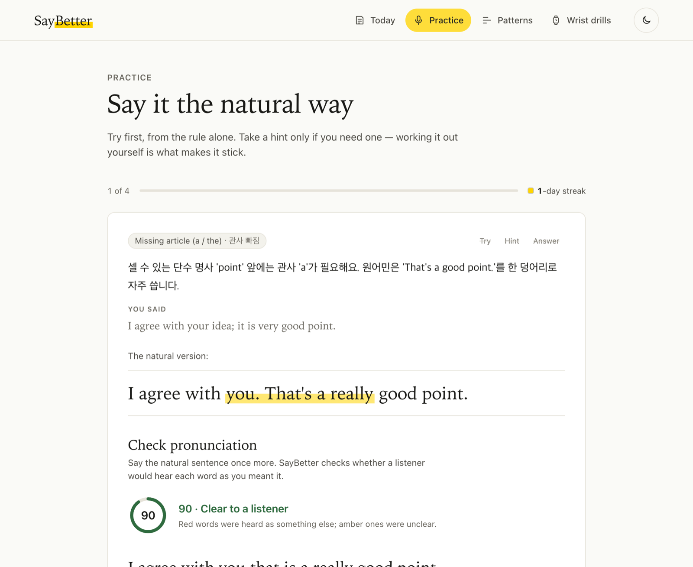
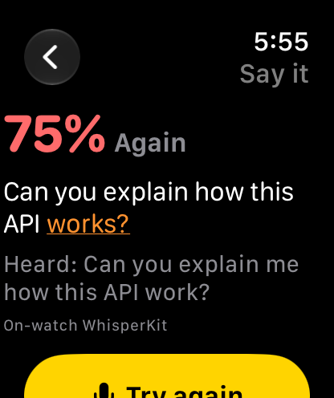
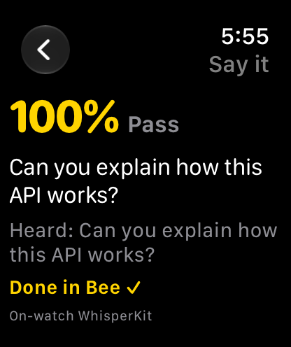
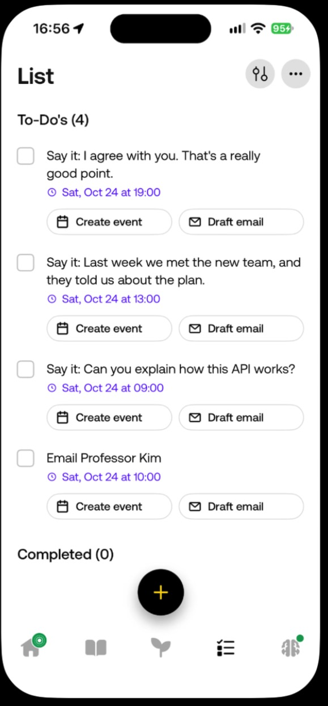
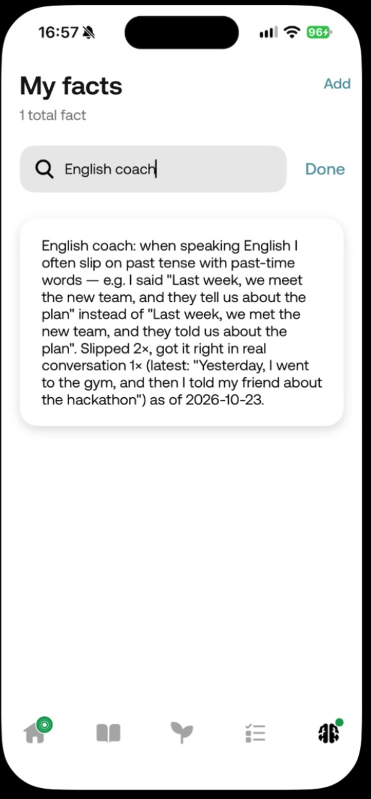

# SayBetter

**An English speaking coach built from what you actually said today — grammar from real conversations, pronunciation from practice.**

Language apps make you practise inside the app. But the mistakes that matter happen in real conversations — on calls,
at work, with friends — and nobody is there to catch them. **SayBetter** uses [Bee](https://bee.computer) on an
Apple Watch to collect the English you really spoke, coaches every sentence that needs it (with an explanation in your
own language), turns the best corrections into **drills that buzz on your wrist tomorrow**, saves your recurring
mistakes to **Bee's memory**, and then notices when you **get them right in a real conversation**.

> Built for the Bee track of *Build, Ship, Shape: Amazon Developer Hackathon* (October 2026).
> Demo video: https://youtu.be/ — *(link added on submission)*

| Today | Practice |
|---|---|
|  |  |
| **Patterns** | **Wrist drills** |
|  |  |

| Pronunciation check (my real attempt) | Watch drill app (watchOS simulator) |
|---|---|
|  |   |

| Drills in the Bee app (real) | What Bee remembers (real) |
|---|---|
|  |  |

## The loop

```
 Apple Watch + Bee app ──► Bee cloud transcription
                                  │
          ┌───────────────────────┴────────────────────────┐
          ▼ live: bee stream --json                         ▼ nightly: bee conversations transcript
   saybetter watch                                    saybetter review   (launchd, 22:00)
          │                                                 │
          └──────────► English-only filter (code-switch aware) ◄──┘
                                  │
                                  ▼
                 LLM coach  (Claude via Claude Code headless · Gemini · offline rules)
          fix · natural version · Korean explanation · pattern · severity
          "used_correctly": a known weak pattern said RIGHT in real life
                                  │
     ┌──────────────┬─────────────┼──────────────────┬───────────────────────┐
     ▼              ▼             ▼                  ▼                       ▼
 macOS notice   daily notebook   bee todos create    bee facts create/update  real-life wins
 (live)         + web UI         "Say it: …" with    "I often slip on …        (wins.jsonl)
                (Today/Practice/  alarms 09/13/19     Slipped 2×, got it
                 Patterns/Drills) → wrist             right 1×"
```

Every arrow that touches Bee is a real call at runtime: `bee stream`, `bee conversations list/transcript`,
`bee todos create`, `bee facts create`, `bee facts update` — plus an **Agent Skill** (`skills/saybetter-coach`) that lets
Claude Code / Codex quiz you using the Bee MCP server.

## Pronunciation

Bee keeps no raw audio, so pronunciation is checked where SayBetter *does* get audio: when you practise.
In Practice you say the corrected sentence; the browser records it and `POST /api/pronounce` runs **whisper.cpp
locally** with word-level probabilities, aligns the words with the sentence you meant (contractions expanded) and
marks each word **ok**, **amber** (unclear) or **red** (heard as a different word), with Korean tips for the sounds
Korean speakers find hard (th, r/l, v/b, f/p, final -s/-ed). Up to three tries — the Duolingo/Busuu principle
("was it understood as intended?"), but on *your own* sentences. Results feed "Sounds to work on" in Patterns.

Needs a whisper.cpp model, e.g. `ggml-large-v3-turbo-q5_0.bin` in `~/.cache/whisper-cpp/`
(or `SAYBETTER_WHISPER_MODEL=/path/to/model.bin`) and `brew install whisper-cpp ffmpeg`.

## Watch drill app (`watch/`)

**SayBetter Drill** (SwiftUI, watchOS 10+) closes the loop on the wrist: it loads tomorrow's drills from Bee via
`GET /api/drills`, you say the sentence into the watch, it transcribes **on the watch with WhisperKit**
(`openai_whisper-tiny.en`) and aligns it with the target; on a pass it calls `POST /api/drills/complete`, which runs
`bee todos complete <id>` — the drill is marked done **in Bee**. If on-device transcription is not possible it falls
back to the Mac's whisper.cpp. Status: runs end to end in the watchOS simulator; signing for a physical Apple Watch SE 3
succeeded, installation is pending (device tunnel). Build with `xcodegen` + Xcode; see `watch/README.md`.
Run the server with `SAYBETTER_HOST=0.0.0.0 saybetter serve` so the watch can reach it on the LAN.

## What makes it different

Speak, ELSA, Ringle, Loora and Duolingo all score practice **inside the app**. The few tools that look at real speech
(ELSA Speech Analyzer, Yoodli, Ringle's lesson analysis) analyse one recorded call. SayBetter is the loop none of them
close: *your whole day of real English → focused corrections → drills on your wrist → and proof that you fixed it in
your next real conversation.* The headline metric is not a practice score; it is **real-life wins**.

Design choices backed by what learners and research say works:
- **Correct only what matters** (Loora limits spoken corrections to a few; overload kills motivation): at most 8 items a
  day, most important first, ASR artefacts ignored.
- **Two-step correction** — minimal fix first, then what a native speaker would actually say.
- **Elicitation before the answer** (corrective-feedback research): Practice shows the rule first, then a cloze hint,
  then the answer.
- **Your own sentences as spaced-repetition cards** (Anki/말해보카 style Leitner boxes: 1, 3, 7, 14 days).
- **One thing a day** (Loora's key takeaway, Ringle's focus areas): Today opens with a single pattern to work on, and
  tomorrow's drills focus on it.

## Quick start

```bash
git clone https://github.com/1jsjs/saybetter && cd saybetter
npm test                      # 35 tests, zero dependencies
npm link                      # puts `saybetter` on your PATH

# Bee CLI: enable Developer Mode in the Bee iOS app (Settings → tap Version 5×), then
npm i -g @beeai/cli && bee login

saybetter watch               # live coaching while you talk (macOS notifications)
saybetter review              # today's review → notebook, wrist drills, Bee facts
saybetter serve --open        # the web UI on http://localhost:4173
saybetter schedule --at 22:00 # nightly review via launchd
```

No Bee device? Everything runs offline on a recorded Bee stream with the deterministic coach:

```bash
SAYBETTER_LLM=fake SAYBETTER_HOME=/tmp/sb node bin/saybetter.js watch --dry-run --input fixtures/stream-sample.jsonl --window 1
SAYBETTER_HOME=/tmp/sb node bin/saybetter.js serve --open   # shows sample data when empty
```

| Command | What it does |
|---|---|
| `saybetter watch [--window 8]` | follows `bee stream`, coaches English within seconds, notifies, records wins |
| `saybetter review [--today\|--minutes N\|--conversation ID] [--drills 3]` | coaches what's new, writes the notebook, schedules ≤3 drills/day, saves/updates Bee facts |
| `saybetter check "<sentence>"` | coach one sentence |
| `saybetter patterns` | your top mistake patterns |
| `saybetter serve [--port 4173] [--open]` | local web UI |
| `saybetter schedule [--at 22:00] [--remove]` | nightly review with launchd |

| Env | Meaning | Default |
|---|---|---|
| `SAYBETTER_LLM` | `claude` (Claude Code CLI, headless) · `gemini` (`GEMINI_API_KEY`) · `fake` (offline rules) | `claude` |
| `SAYBETTER_HOME` | where the notebook, drills, facts and wins live | `~/.saybetter` |

## How it is built

- Node.js ≥ 20, **zero npm dependencies**; every Bee call goes through the official CLI so it uses your `bee login`.
- `src/english.js` keeps only English, including English stretches inside Korean code-switched speech.
- `src/coach.js` holds the prompt and normalises the model's JSON; `fakeCoach` is a deterministic rule engine for tests
  and offline demos. We benchmarked LanguageTool and Harper on real learner sentences: rule engines caught 2/5 and 0/5
  of the speaking mistakes an LLM caught 5/5 (tense with time words, articles, *explain me*), so the LLM is the coach
  and rules are the offline fallback.
- `src/server.js` + `ui/` — a dependency-free web UI (hash routes, dark mode, mobile tab bar, Web Speech API practice,
  `speechSynthesis` to listen) reading plain files in `~/.saybetter`.
- Data stays on your machine; transcripts go only to the LLM backend you choose.

## Privacy

SayBetter reads only **your own** Bee account. Bee transcripts do not label speakers on the live stream, so use it when
you are the one speaking English or everyone present has agreed to Bee listening. It never coaches other people.

## Files written to `~/.saybetter`

`history.jsonl` (every coached sentence) · `reports/YYYY-MM-DD.{json,md}` · `drills.json` · `facts.json` ·
`wins.jsonl` · `practice.jsonl` · `state.json` · `events.jsonl` (raw Bee events for debugging).

Developer notes from building on Bee: [FRICTION_LOG.md](FRICTION_LOG.md).

## License

MIT
